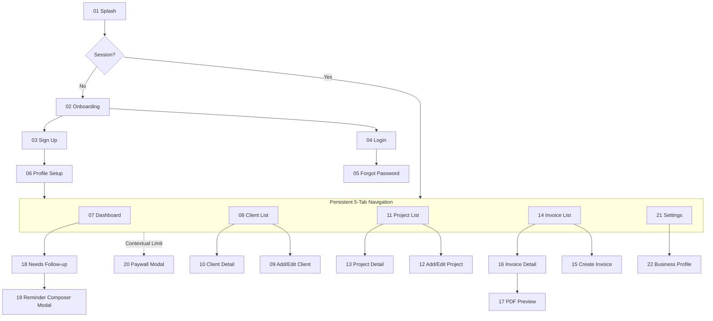

# ClientTrack — Frontend UI/UX Specification

---

## 1. Design Principles

ClientTrack is engineered with a **calm, confidence-inspiring, and frictionless** design aesthetic tailored specifically for solo business operators.
- **Clarity Over Clutter**: Solo operators are busy. Screen layouts answer the immediate question: *"What do I need to do right now?"*
- **Action-Oriented Cashflow**: Urgent states (overdue invoices, pending follow-ups) are highlighted with disciplined semantic colors, making action effortless.
- **Dignified & Professional Tone**: Invoicing communications avoid aggressive jargon. Visuals foster positive client relationships rather than adversarial pressure.
- **Native Platform Feel**: Touch targets, transitions, and native bottom sheets adhere to iOS Human Interface Guidelines and Android Material 3 ergonomics.

---

## 2. Design Tokens

### 2.1 Color Palette

| Token Name | Hex Code | Role / Usage |
| :--- | :--- | :--- |
| `primaryForest` | `#2E5D31` | Brand primary color, primary buttons, active bottom nav icon, key branding elements |
| `midGreen` | `#5B8F4F` | Secondary brand accents, subtle icons, active tab underlines |
| `accentTealGreen`| `#3FAE7C` | Success states, "Paid" status chip, positive cashflow indicators |
| `deepTeal` | `#2F7A6A` | Pro badge accents, secondary interactive highlights |
| `background` | `#F6F9F6` | Default scaffold background, soft off-white green-tinted canvas |
| `surface` | `#FFFFFF` | Card surfaces, modal sheets, input backgrounds, navigation bar |
| `border` | `#E1E8E2` | Hairline borders, card outlines, list row dividers |
| `textPrimary` | `#1B2A1E` | High-contrast body text, primary card headers, titles |
| `textSecondary` | `#6B7A6E` | Subtitles, timestamps, placeholder text, secondary labels |
| `overdueRed` | `#D64545` | Overdue invoice chips, urgent alert banners, overdue totals |
| `dueSoonAmber` | `#E0A030` | Due-soon status chips, approaching deadline warnings |
| `sentBlue` | `#4A6FA5` | Sent/Shared status chips, outbound reminder badges |
| `goldPro` | `#D4AF37` | "PRO" badge background pill, sparkle icons |

### 2.2 Typography Scale (Inter Font Family)

| Style Token | Font Size | Weight | Line Height | Usage |
| :--- | :---: | :---: | :---: | :--- |
| `DisplayLarge` | 32 pt | Bold (700) | 38 pt | Main dashboard metrics |
| `TitleLarge` | 24 pt | SemiBold (600) | 30 pt | Screen headers, modal sheet titles |
| `TitleMedium` | 18 pt | SemiBold (600) | 24 pt | Card headers, section dividers |
| `BodyLarge` | 16 pt | Regular (400) | 22 pt | Primary form input text, list titles |
| `BodyMedium` | 14 pt | Regular (400) | 20 pt | Secondary descriptions, line item rows |
| `LabelLarge` | 14 pt | SemiBold (600) | 18 pt | Button labels, chip text |
| `LabelSmall` | 11 pt | Medium (500) | 14 pt | Pro badges, timestamps, helper text |

### 2.3 Spacing, Radii, and Elevations
- **Side Padding**: 20 px horizontal page margin.
- **Card Radius**: 16 px (`BorderRadius.circular(16)`).
- **Button Height & Radius**: Height 52 px, radius 14 px.
- **Input Field Height & Radius**: Height 52 px, radius 12 px.
- **Chip Radius**: Fully rounded pill (`BorderRadius.circular(20)`).
- **Elevations**: Flat / Neomorphic styling (`0dp` elevation with `1px` border `#E1E8E2`; soft shadow `rgba(0, 0, 0, 0.04)` with `8px` blur on cards).

### 2.4 Flutter ThemeData Mapping
```dart
final appTheme = ThemeData(
  useMaterial3: true,
  scaffoldBackgroundColor: const Color(0xFFF6F9F6),
  fontFamily: 'Inter',
  colorScheme: const ColorScheme(
    brightness: Brightness.light,
    primary: Color(0xFF2E5D31),
    onPrimary: Colors.white,
    secondary: Color(0xFF5B8F4F),
    onSecondary: Colors.white,
    surface: Color(0xFFFFFFFF),
    onSurface: Color(0xFF1B2A1E),
    error: Color(0xFFD64545),
    onError: Colors.white,
  ),
  dividerTheme: const DividerThemeData(color: Color(0xFFE1E8E2), thickness: 1),
  cardTheme: CardTheme(
    color: Colors.white,
    elevation: 0,
    shape: RoundedRectangleBorder(
      borderRadius: BorderRadius.circular(16),
      side: const BorderSide(color: Color(0xFFE1E8E2), width: 1),
    ),
  ),
);
```

---

## 3. Reusable Component Library

1. **Buttons**:
   - `PrimaryButton`: 52px height, forest green `#2E5D31` background, white label, full-width. Disabled state: 40% opacity.
   - `SecondaryButton`: 52px height, white surface with `#E1E8E2` border, `#1B2A1E` label.
   - `GhostButton`: Text-only with green label, zero elevation.
   - `FAB`: 56px circular floating action button, forest green with white `+` icon.
2. **Inputs**:
   - `CustomTextField`: 52px height, 12px radius, `#E1E8E2` border (focus: `#2E5D31` 1.5px), hint text `#6B7A6E`.
   - `DatePickerField`: Input box triggering native modal calendar picker.
3. **Status Chips (Pill Shaped)**:
   - `Paid`: Background `#E8F7F0`, text `#3FAE7C`.
   - `Overdue`: Background `#FDEEEE`, text `#D64545`.
   - `Due Soon`: Background `#FEF8EC`, text `#E0A030`.
   - `Sent / Shared`: Background `#EEF3F8`, text `#4A6FA5`.
   - `Draft`: Background `#F0F3F0`, text `#6B7A6E`.
4. **PRO Badge**: Small pill with gold/green gradient (`#D4AF37` / `#2E5D31`), white 11pt text, and leading sparkle icon `✦ PRO`.
5. **Cards**:
   - `MetricCard`: Displays large bold metric, subtitle, and trend icon.
   - `NeedsFollowUpCard`: Highlight card on Dashboard with overdue count and "Review & Chase" button.
6. **Bottom Sheets & Dialogs**:
   - Rounded top borders (24px radius), grab handle bar at top, clean action buttons.
7. **Empty & Error States**:
   - Clean outline illustration, supportive headline, descriptive body text, and prominent action button.

---

## 4. Navigation Map & Bottom Navigation Shell



### Bottom Navigation Tabs (Visible on 5 Screens Only):
1. **Home**: `07 Dashboard`
2. **Clients**: `08 Client List`
3. **Projects**: `11 Project List`
4. **Invoices**: `14 Invoice List`
5. **Settings**: `21 Settings`

---

## 5. Screen-by-Screen Specifications

### Screen 01: Splash Screen
- **Reference**: `visily-01-splash.png`
- **Purpose**: Initial application bootstrapping, authentication state verification, and branding display.
- **Layout**: Centered app logo (`assets/app-logo.png`), app name "ClientTrack", tagline *"Get paid on time, every time."*, and subtle bottom loading spinner.
- **Acceptance Criteria**: Seamlessly transitions to `/dashboard` if user session is active, or `/onboarding` if first launch / unauthenticated.

### Screen 02: Onboarding
- **Reference**: `visily-02-onboarding.png`
- **Purpose**: Introduce the core value proposition: manage work, send invoices, and chase late payments natively.
- **Layout**: 3-slide swipeable carousel with indicators:
  1. *Track Projects & Invoices with Ease*
  2. *Get Paid Faster with Payment Chaser*
  3. *Keep 100% Control of Client Relationships*
- **Actions**: "Get Started" (routes to `/auth/signup`), "Log In" (routes to `/auth/login`).

### Screen 03: Sign Up
- **Reference**: `visily-03-sign-up.png`
- **Purpose**: Register new user account.
- **Layout**: Back button, title *"Create Account"*, fields: Full Name, Email, Password (with eye toggle), "Sign Up" primary button, Terms & Privacy disclaimer text, and link to Login.
- **Validation**: Email must be valid; password $\ge 8$ chars.

### Screen 04: Login
- **Reference**: `visily-04-login.png`
- **Purpose**: Authenticate existing user.
- **Layout**: Title *"Welcome Back"*, fields: Email, Password, "Forgot Password?" text button, "Log In" primary button, link to Sign Up.

### Screen 05: Forgot Password
- **Reference**: `visily-05-forgot-password.png`
- **Purpose**: Dispatch password reset link.
- **Layout**: Back arrow, title *"Reset Password"*, description *"Enter your email to receive a password reset link."*, Email input, "Send Reset Link" button.

### Screen 06: Profile Setup
- **Reference**: `visily-06-profile-setup.png`
- **Purpose**: First-run business configuration (skippable).
- **Layout**: Title *"Setup Your Profile"*, fields: Business Name (defaults to Full Name), Currency Selector (USD, EUR, GBP, etc.), Phone Number, "Complete Setup" button, "Skip for Now" text button.

### Screen 07: Dashboard (Tab 1)
- **Reference**: `visily-07-dashboard.png`
- **Purpose**: Executive daily summary answering *"What do I need to do today?"*.
- **Layout**:
  1. Top App Bar: Greeting (*"Good morning, {name}"*) + Pro Badge.
  2. Financial Metrics: Outstanding balance (bold), Earned this month (teal), Overdue balance (red).
  3. **Needs Follow-up Action Card**: Prominent banner displaying count of overdue invoices + "Review & Chase" button (routes to Screen 18).
  4. Active Projects: Count of active projects and next 3 nearest deadlines.
  5. Recent Invoices: Last 3 created invoices with status chips.

### Screen 08: Client List (Tab 2)
- **Reference**: `visily-08-client-list.png`
- **Purpose**: Directory of all client contacts.
- **Layout**: Search bar, client count pill, scrollable list of clients (name, company, outstanding balance, reliability badge), FAB to add client.
- **Gating**: Tapping FAB when count $\ge 3$ on Free tier opens Paywall Modal.

### Screen 09: Add / Edit Client
- **Reference**: `visily-09-add-edit-client.png`
- **Purpose**: Create or modify client contact details.
- **Layout**: Name (required), Email, Phone, Company, Notes, "Save Client" button. Delete button (if editing) with confirmation dialog.

### Screen 10: Client Detail
- **Reference**: `visily-10.-client-details.png`
- **Purpose**: Comprehensive view of client engagements and creditworthiness.
- **Layout**:
  1. Header: Client Name, Company, direct call/email quick actions.
  2. **Payment History Section**: Average days late, On-time %, Reliability Badge (*Reliable* / *Sometimes Late* / *Chronically Late*). (Free tier shows basic stats; Pro unlocks full breakdown).
  3. Financial Summary: Total billed, Total paid, Outstanding.
  4. Linked Projects & Invoices tabs.

### Screen 11: Project List (Tab 3)
- **Reference**: `visily-11-project-list.png`
- **Purpose**: Overview of all client deliverables.
- **Layout**: Filter chips (*All*, *In Progress*, *Completed*), project cards showing title, client name, rate, deadline badge, and "Create Invoice" quick action. FAB to add project.

### Screen 12: Add / Edit Project
- **Reference**: `visily-new-project.png`
- **Purpose**: Create or edit project scope.
- **Layout**: Title (required), Client selector dropdown, Rate type segmented control (*Fixed* / *Hourly*), Rate input, Deadline date picker, Status selector, "Save Project" button.

### Screen 13: Project Detail
- **Reference**: `visily-project-details.png`
- **Purpose**: Project inspection and invoice generation.
- **Layout**: Title, Client name, Status badge, Rate & Deadline info, Description, Invoices generated under this project, and prominent "Create Invoice" primary button.

### Screen 14: Invoice List (Tab 4)
- **Reference**: `visily-invoices.png`
- **Purpose**: Comprehensive invoice ledger.
- **Layout**: Status filter chips (*All*, *Overdue*, *Due Soon*, *Paid*, *Draft*), search bar, invoice cards (number, client name, due date, amount, status chip), FAB to create invoice.
- **Gating**: Tapping FAB when count $\ge 5$ on Free tier opens Paywall Modal.

### Screen 15: Create Invoice
- **Reference**: `visily-15-create-invoice.png`
- **Purpose**: Draft and itemize a new invoice.
- **Layout**: Client selector, Project selector (optional), Auto-generated Invoice # (editable), Issue Date, Due Date, Line Items table (+ Add Line Item button), Subtotal, Total, Notes field, "Save & Preview" button.

### Screen 16: Invoice Detail
- **Reference**: `visily-16.-invoice-detail.png`
- **Purpose**: Detailed inspection, payment reconciliation, and chasing triggers.
- **Layout**: Invoice #, Status chip, Client contact block, Issue/Due dates, Line items summary, Subtotal/Total, "Mark as Paid" button, "Share Reminder" button, "View PDF" button.

### Screen 17: PDF Preview
- **Reference**: `visily-17-pdf-preview.png`
- **Purpose**: High-fidelity invoice render and native dispatch.
- **Layout**: Full-screen interactive PDF viewer showing clean layout with user branding, client details, line items, and watermark (Free tier only: *"Made with ClientTrack"*). Bottom action bar: "Share PDF" button opening native OS share sheet.

### Screen 18: Needs Follow-up (Payment Chaser Cockpit)
- **Reference**: `visily-18-needs-follow-up.png`
- **Purpose**: High-urgency hub displaying overdue and due-today invoices requiring chasing.
- **Layout**: Total overdue amount banner, list of urgent invoice cards showing client name, invoice number, amount, days overdue, last shared reminder date, and prominent "Chase" button (routes to Screen 19).

### Screen 19: Reminder Composer (Modal Sheet)
- **Reference**: `visily-send-reminder.png`
- **Purpose**: Draft and natively dispatch escalating follow-up communications.
- **Layout**:
  1. Template Selector tabs: *Friendly*, *Professional*, *Final*.
  2. Editable message preview box auto-filled with client name, amount, invoice #, and due date.
  3. Action Buttons: WhatsApp direct link, SMS direct link, Email direct link, and Native Share Sheet.
  4. P1 AI Polish button (sparkle icon with PRO badge).
- **Gating**: When lifetime shares $\ge 3$ on Free tier, tapping share buttons opens Paywall Modal.

### Screen 20: Paywall (Modal)
- **Reference**: `visily-clienttrack-pro-upgrade.png`
- **Purpose**: Conversion engine for ClientTrack Pro.
- **Layout**:
  1. Header: Sparkle icon, *"Unlock ClientTrack Pro"*.
  2. Value Checklist: Unlimited clients & invoices, unlimited payment reminders, watermark-free PDFs, full payment history analytics, AI reminder polishing.
  3. Pricing Selector:
     - **Annual**: $59.99 / year ($4.99/mo, Save 50% — Best Value).
     - **Monthly**: $9.99 / month.
  4. Primary Button: *"Start Pro Subscription"*.
  5. Footer: "Restore Purchases", Terms of Service, Privacy Policy.

### Screen 21: Settings (Tab 5)
- **Reference**: `visily-settings.png`
- **Purpose**: User preferences, subscription status, and account governance.
- **Layout**:
  1. Profile card (Name, Business Name, Email) with "Edit Profile" link.
  2. Subscription section: Status (*Free* or *Pro*), "Upgrade to Pro" or "Manage Subscription", "Restore Purchases".
  3. Preferences: Default currency, default payment terms (e.g. Net 14).
  4. Developer / Demo: "Load Demo Data" button, "Clear Demo Data" button.
  5. Legal: Privacy Policy link, Terms of Service link.
  6. Account Actions: "Log Out", "Delete Account" (red danger button).

### Screen 22: Business Profile
- **Reference**: `visily-business-profile.png`
- **Purpose**: Manage business details displayed on generated invoice headers.
- **Layout**: Business Name, Contact Email, Contact Phone, Physical Address, Tax ID / Notes, Logo Upload button (P1 Pro only), "Save Changes" button.

---

## 6. Global Behaviors & Formatting Rules

- **Currency Formatting**: Detail views display currency symbol with two decimal places (e.g., `$1,250.00`). Dashboard header summary cards display whole dollars (e.g., `$1,250`).
- **Date Formatting**: Displayed as `MMM dd, yyyy` (e.g., `Oct 14, 2026`).
- **Destructive Confirmations**: Deleting a client, project, invoice, or account triggers a modal confirmation dialog requiring explicit intent.
- **Haptic Feedback**: Subtle haptic feedback (`HapticFeedback.lightImpact()`) triggered on successful share button taps, invoice status updates, and paywall package selection.

---

## 7. Copy and Tone Guidelines

Strict terminology rules must be maintained throughout the user interface:
- **Use**: *"Share reminder"*, *"Shared"*, *"Save & share"*, *"Payment Chaser"*, *"Needs Follow-up"*.
- **Never Use**: *"Send"*, *"Automated"*, *"Payment link"*, *"Delivery confirmed"*.
- *Rationale*: Because dispatch occurs via external native applications without delivery callbacks, records are factually marked as **"Shared"**.

---

## 8. Free-Tier vs. Pro UI Rules

- **Pro Badges**: Appear as elegant gold/green pills (`✦ PRO`) on locked features (e.g., AI Polish button, full analytics risk card, logo upload).
- **Graceful Paywall Triggers**: Limits are communicated positively (e.g., *"You've hit your 3 client limit. Unlock unlimited clients with Pro."*), never making the free tier feel broken or incomplete.

---

## 9. Accessibility Specifications

- **Minimum Touch Targets**: All interactive buttons, icon buttons, and list row actions maintain minimum $44 \times 44$ pt touch bounds.
- **Color Contrast**: All text elements exceed WCAG AA standards (minimum 4.5:1 ratio against `#FFFFFF` or `#F6F9F6`).
- **Dynamic Type**: Text components scale gracefully up to 200% system font sizing without clipping.

---

## 10. Assets Inventory

### Existing Assets Found in `assets/`:
- `app-logo.png` (High-resolution raster branding image, 1.5MB).

### Required Production Assets to Generate [VERIFY]:
1. Vector SVG version of `app-logo.svg` for sharp scaling.
2. Android Adaptive Icon: `ic_launcher_foreground.png` and `ic_launcher_background.png` (432x432 px).
3. iOS App Store Icon: `AppIcon-1024.png` (1024x1024 px, zero transparency).

---

## 11. Known Deviations in `UI_Screens/` Corrected by this Spec

| Mockup Screen | Deviation in Visily File | Correct Specification (This Document) |
| :--- | :--- | :--- |
| `visily-send-reminder.png` | Uses button label *"Send Reminder"* | Changed to **"Share Reminder"** (OS share sheet). |
| `visily-invoices.png` | Includes mock *"Pay with Stripe / Link"* | Removed; payment gateway is strictly out of scope. |
| `visily-15-create-invoice.png`| Includes *"Tax Rate %"* and *"Website"* | Omitted from v1 P0 to protect MVP simplicity. |
| `visily-18-needs-follow-up.png`| Displays *"Recently Contacted"* | Replaced with factual **"Last Shared: [Date]"**. |

---

## 12. Missing Designs & State Specifications

Screens not fully rendered in Visily mockups that are specified above:
1. **Notification Permission Sheet**: Half-sheet explaining why local notifications keep invoices on track before invoking OS permission dialog.
2. **"Did You Send It?" Sheet (P1)**: Friendly confirmation sheet upon returning from WhatsApp/SMS asking *"Did you share the reminder?"* before logging history.
3. **Limit Reached Bottom Sheet**: Contextual mini-paywall sheet triggered when hitting 3 clients, 5 invoices, or 3 shares.
4. **Delete Account Danger Modal**: Double-confirmation sheet highlighting data erasure and subscription store notice.
