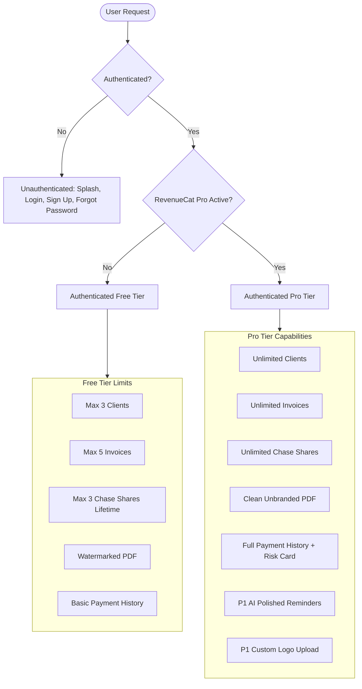
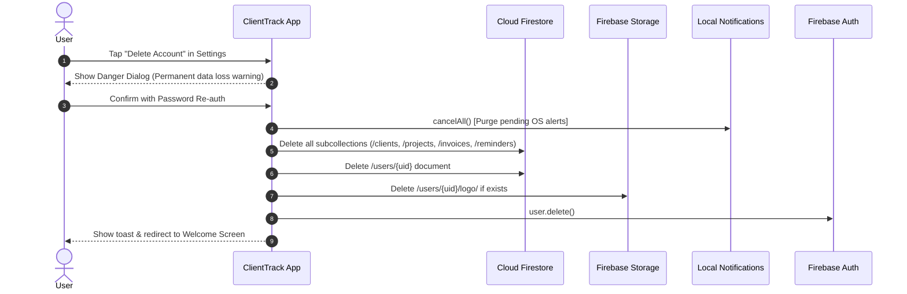

# ClientTrack — Security, Access Control & Privacy Specification

---

## 1. Security Goals and Threat Model

ClientTrack protects high-value business assets belonging to independent freelancers and their clients. Because the application handles client contact records, financial invoicing totals, and subscription access tokens, our security model follows **defense-in-depth, zero-trust cloud data partitioning, and complete client-side data minimization**.

### 1.1 Primary Assets

| Asset | Sensitivity | Description | Impact of Compromise |
| :--- | :---: | :--- | :--- |
| **Client PII** | High | Client names, emails, phone numbers, and physical company addresses. | Privacy violation, reputational damage, GDPR/CCPA liability. |
| **Invoice Records** | High | Itemized services, billing rates, subtotal/total amounts, and payment status. | Confidentiality breach of freelance pricing and revenue. |
| **Financial Totals** | High | Aggregated monthly earnings, outstanding debts, and overdue balances. | Financial surveillance of solo operator cashflow. |
| **Subscription State**| Medium| RevenueCat entitlement token (`clienttrack_pro`) and receipt status. | Revenue loss via illegitimate feature unlocking. |
| **Authentication Creds**| High | Firebase Auth session tokens and password hashes. | Unauthorized account takeover and data exfiltration. |

### 1.2 Threat Modeling Matrix

| Threat ID | Threat Vector | Likelihood | Impact | Mitigation Strategy |
| :--- | :--- | :---: | :---: | :--- |
| **T-01** | Cross-User Data Access (Firestore IDOR) | High | Critical | Strict Firestore security rules enforcing `request.auth.uid == userId` for all read/write paths under `/users/{userId}/**`. Default deny. |
| **T-02** | Local Client Manipulation / Jailbreak | Medium | Low | Subscription receipts validated cryptographically by RevenueCat backend. AI polishing protected by server-side Cloud Function token verification. |
| **T-03** | LLM API Key Exfiltration | High | Critical | LLM API key stored exclusively in Google Cloud Secret Manager; never present in Flutter client code or bundle assets. |
| **T-04** | Client PII Leakage via Crash Logs | Medium | High | Strict PII-free logging policy. Masked crash metrics; zero phone numbers, emails, or invoice sums emitted. |
| **T-05** | Unauthorized Account Deletion | Low | High | Mandatory recent re-authentication check before destructive user deletion execution. |
| **T-06** | Man-in-the-Middle (MitM) Inspection | Low | High | TLS 1.3 enforced for all Firebase, RevenueCat, and Cloud Function API endpoints. |

---

## 2. Authentication

### 2.1 Password and Session Rules
- **Authentication Engine**: Firebase Authentication (Email / Password).
- **Password Complexity**: Minimum 8 characters; enforced client-side and verified via Firebase Auth server configuration.
- **Session Tokens**: Handled automatically via Firebase Auth JWT refresh cycles. Tokens persist in secure hardware-backed storage (iOS Keychain / Android EncryptedSharedPreferences).
- **Password Reset**: Automated secure reset email links sent via Firebase Auth with short token expiration (15 minutes).

### 2.2 Re-Authentication Protocol
Destructive account actions (specifically Account Deletion) require re-authentication if the user's auth token was issued $>5$ minutes prior:
```dart
Future<void> reauthenticateAndExecute(String email, String password, Future<void> Function() action) async {
  final user = FirebaseAuth.instance.currentUser;
  final cred = EmailAuthProvider.credential(email: email, password: password);
  await user?.reauthenticateWithCredential(cred);
  await action();
}
```

### 2.3 Social Providers (P1)
- **Android**: Google Sign-In via `google_sign_in` plugin, exchanging Google ID tokens for Firebase credentials.
- **iOS**: Sign in with Apple via `sign_in_with_apple` plugin, strictly adhering to Apple Review Guideline 4.8 when third-party social logins are offered.

---

## 3. Roles and Access Levels

ClientTrack operates with three distinct access tiers. There is **no admin role** or shared multi-user access in v1.



### Access Matrix

| Capability | Unauthenticated | Authenticated Free | Authenticated Pro |
| :--- | :---: | :---: | :---: |
| Access Public Screens (Login/Signup/Forgot) | Yes | N/A (Redirected) | N/A (Redirected) |
| Access Core Dashboard & Local Database | No | Yes | Yes |
| Create Clients | No | Up to 3 | Unlimited |
| Create Invoices | No | Up to 5 | Unlimited |
| Share Payment Reminders | No | Up to 3 Lifetime | Unlimited |
| Generate Clean (Unbranded) PDF | No | No (Watermarked) | Yes |
| View Full Client Payment History & Risk Card | No | No (Basic Stats) | Yes |
| Access AI Polished Reminders (P1) | No | No | Yes |
| Upload Business Logo (P1) | No | No | Yes |
| Export Accounting Data to CSV (P2) | No | No | Yes |

---

## 4. Feature Entitlement Model

### Client-Side Gating vs. Security Boundary
- **Client-Side UX Gating**: In-app limits (e.g. blocking the 4th client or 6th invoice) are managed by Riverpod providers checking RevenueCat's cached customer info. This ensures an instantaneous, smooth user experience.
- **Security Boundary Definition**: Because client code running on a jailbroken or rooted device can theoretically be patched, client-side limits are treated as **UX Controls**.
- **Real Security Boundaries**:
  1. **User Data Isolation**: Guaranteed by Firestore Security Rules. User A can never read or write User B's data under any circumstance.
  2. **Cost-Bearing Services**: The P1 AI Reminder Cloud Function acts as an authenticated security gate. It queries the RevenueCat REST API using the user's verified Firebase UID to ensure the user possesses an active `clienttrack_pro` entitlement before invoking expensive LLM APIs.

---

## 5. Cloud Firestore Security Rules

The following rules must be deployed to Cloud Firestore to enforce strict multi-tenant isolation and schema validation:

```javascript
rules_version = '2';
service cloud.firestore {
  match /databases/{database}/documents {

    // Helper functions
    function isAuthenticated() {
      return request.auth != null;
    }

    function isOwner(userId) {
      return isAuthenticated() && request.auth.uid == userId;
    }

    // Default deny all top-level access
    match /{document=**} {
      allow read, write: if false;
    }

    // Per-user subcollections isolation
    match /users/{userId} {
      allow read, write: if isOwner(userId);

      match /clients/{clientId} {
        allow read, write: if isOwner(userId);
      }

      match /projects/{projectId} {
        allow read, write: if isOwner(userId);
      }

      match /invoices/{invoiceId} {
        allow read, write: if isOwner(userId);
      }

      match /reminders/{reminderId} {
        allow read, write: if isOwner(userId);
      }
    }
  }
}
```

### Firestore Security Rules Test Plan
1. **Unauthenticated Read/Write**: Verify unauthenticated queries to `/users/{uid}/clients` return `PERMISSION_DENIED`.
2. **Cross-User Snooping**: Verify authenticated user `UID_A` attempting to read `/users/UID_B/invoices` returns `PERMISSION_DENIED`.
3. **Owner Access**: Verify authenticated user `UID_A` can perform full CRUD operations on their own `/users/UID_A/**` subcollections.

---

## 6. Firebase Storage Security Rules (P1 Logo Upload)

```javascript
rules_version = '2';
service firebase.storage {
  match /b/{bucket}/o {
    match /users/{userId}/logo/{fileName} {
      allow read: if request.auth != null && request.auth.uid == userId;
      allow write: if request.auth != null 
                   && request.auth.uid == userId
                   && request.resource.size < 2 * 1024 * 1024 // 2MB Max
                   && request.resource.contentType.matches('image/(jpeg|png)');
      allow delete: if request.auth != null && request.auth.uid == userId;
    }
  }
}
```

---

## 7. Cloud Functions Security (P1 AI Reminder)

1. **Authentication Requirement**: Functions exposed via `onCall` automatically enforce valid Firebase Auth context (`context.auth`).
2. **App Check (Recommended)**: Firebase App Check integrated to protect Cloud Functions from automated bot abuse or non-app traffic.
3. **Server-Side Entitlement Check**: Function verifies active subscription with RevenueCat before processing:
   ```javascript
   const customer = await revenueCatClient.getCustomerInfo(uid);
   if (!customer.entitlements.active['clienttrack_pro']) {
     throw new HttpsError('permission-denied', 'Active ClientTrack Pro subscription required.');
   }
   ```
4. **Rate Limiting**: In-memory Redis or Firestore timestamp tracking enforcing a ceiling of **30 AI polishes per user per day** to control operational costs.
5. **Zero PII in Prompts**: The Cloud Function strips client phone numbers and physical addresses before generating the prompt; only the client's first name, invoice number, and outstanding balance are passed to the LLM.

---

## 8. Data Protection and Privacy

### 8.1 Data Inventory & Minimization
- **Collected Personal Data**: User account email, user business name, user contact phone/email (displayed on invoices).
- **Client Contact Data**: Names, emails, phone numbers entered by the user. This data is strictly processed on the user's behalf and is never aggregated or indexed across accounts.
- **Financial Records**: Itemized line items, amounts, invoice numbers, and payment dates.

### 8.2 Encryption Standards
- **In Transit**: All network requests encrypted via HTTPS / TLS 1.3.
- **At Rest**: Cloud Firestore and Firebase Storage utilize Google-managed AES-256 encryption.
- **On Device**: Local database cache encrypted by native OS file protection mechanisms (iOS Data Protection / Android File-Based Encryption).

### 8.3 External Dispatch & Lock Screen Privacy
- **PDF Generation**: Invoices are rendered directly in volatile app memory or temporary cache; temporary PDF files are purged after sharing.
- **Lock Screen Notifications**: Local push alerts display invoice IDs and due dates but do not display sensitive payment notes or phone numbers.

---

## 9. Account Deletion and Data Lifecycle

### 9.1 In-App Deletion Workflow
To comply with Apple App Store Guideline 5.1.1(v) and Google Play Data Safety policies, users can initiate immediate and permanent deletion within the app:



### 9.2 Subscription Notice
The deletion modal explicitly alerts the user:
> *"Deleting your ClientTrack account permanently erases your clients, projects, and invoices. It DOES NOT automatically cancel your App Store or Google Play subscription. Please manage your active subscription in your device's Store Settings."*

---

## 10. Store Compliance & Disclosures

### 10.1 Apple Privacy Nutrition Labels
- **Data Used to Track You**: None.
- **Data Linked to You**: Contact Info (Email Address, Name, Phone), Financial Info (Payment/Purchase History), User Content (Invoices, Client Records).
- **Data Not Linked to You**: Diagnostics (Crash Data, Performance Metrics).

### 10.2 Google Play Data Safety Form
- **Data Collected & Shared**:
  - Personal Info: Name, Email address, Phone number (App functionality, Account management).
  - Financial Info: Purchase history (RevenueCat monetization).
  - Files and Docs: Generated PDF invoices (Ephemeral, user-initiated sharing).
- **Security Practices**: Data encrypted in transit, user can request data deletion directly in-app.

### 10.3 Third-Party SDK Disclosures
1. **Google Firebase**: Auth session handling, database synchronization, crash logging.
2. **RevenueCat**: In-app purchase verification and entitlement management.
3. **OpenAI / Anthropic (P1)**: Ephemeral text processing for reminder tone rewriting.

---

## 11. Secrets and Key Management

- **Zero Secrets in Repository**: No `.env` files with secret keys, no `service-account.json`, and no raw API private keys committed to Git.
- **Client Public Keys Only**:
  - RevenueCat Public SDK Keys (`appl_...` and `goog_...`) are public identifiers safe for binary inclusion.
  - `google-services.json` and `GoogleService-Info.plist` contain project identifiers and client secrets designed for app bundling, restricted via SHA-1 fingerprinting.
- **Server Keys**: Cloud Functions LLM keys are accessed via Google Cloud Secret Manager runtime bindings.

---

## 12. Secure Development Practices

- **Linting**: Enforcement of `flutter_lints` and strict typing across all data layers.
- **Dependencies**: Automated vulnerability auditing via `flutter pub outdated` and Dependabot alerts.
- **Obfuscation**: Production builds compile with code obfuscation enabled:
  ```bash
  flutter build appbundle --release --obfuscate --split-debug-info=./debug_info
  flutter build ipa --release --obfuscate --split-debug-info=./debug_info
  ```

---

## 13. Security Testing Checklist

- [ ] Unauthenticated requests to Firestore documents return permission denied.
- [ ] Cross-tenant access between two distinct Firebase accounts is impossible.
- [ ] Client phone numbers and invoice details do not appear in console logs during release runs.
- [ ] Account deletion completely purges all data across Firestore subcollections.
- [ ] Password re-authentication triggers successfully before destructive deletion.
- [ ] No API secrets discovered in decompiled APK/IPA packages.

---

## 14. Incident Response Basics

If a sensitive key or service account is inadvertently exposed:
1. **Revoke Immediately**: Revoke the compromised API key in the provider console (OpenAI, Google Cloud, RevenueCat).
2. **Rotate Credentials**: Generate a new secret, update Secret Manager / CI environment variables.
3. **Audit Access Logs**: Inspect Cloud Logging / Firebase Auth logs for unauthorized operations during the exposure window.
4. **Deploy Hotfix**: Push an immediate patched release if a client-side identifier required rotation.

---

## 15. Open Questions (VERIFY)

- **[VERIFY-SEC-01]**: Confirm whether Apple App Store Review mandates a public external web URL for account deletion requests in addition to the in-app deletion button.
- **[VERIFY-SEC-02]**: Confirm whether Google Play requires explicit disclosure of client contacts stored manually by the user as "User Contacts" under the Data Safety Form, or if it falls strictly under "User Data / Documents".
