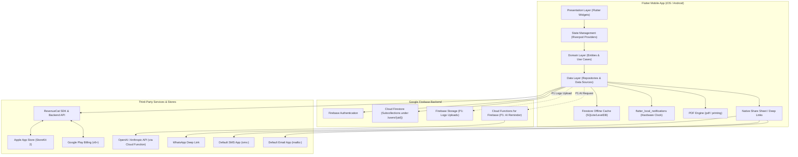
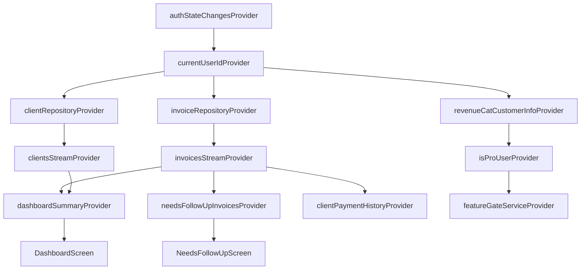
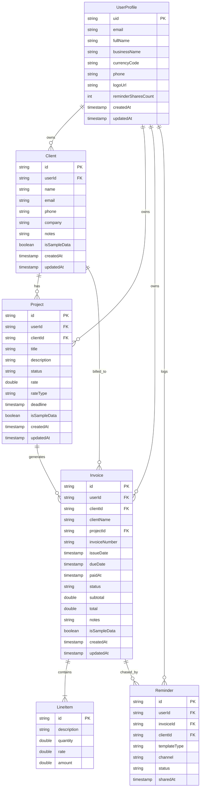
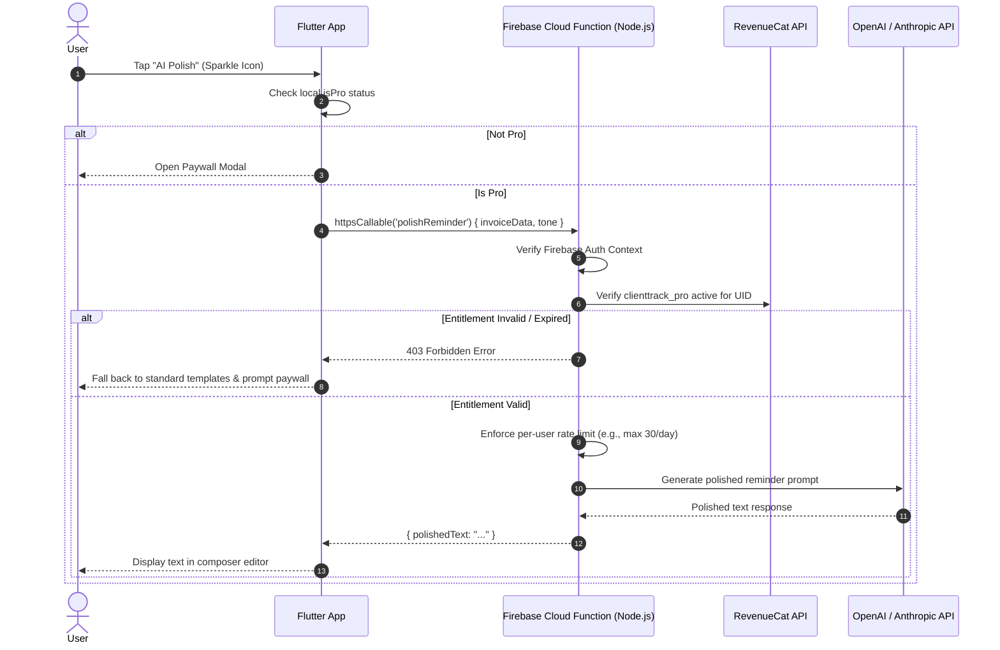
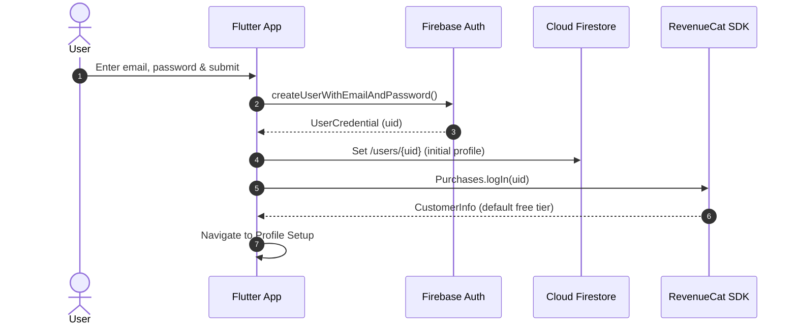
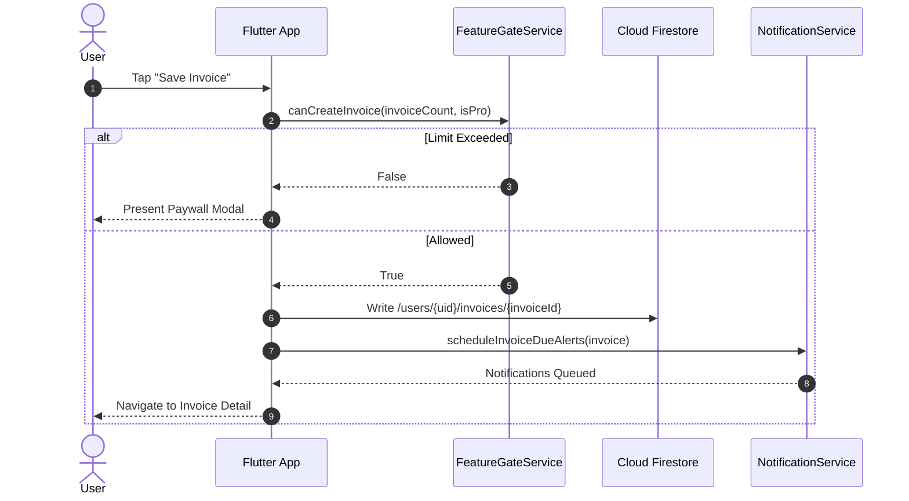
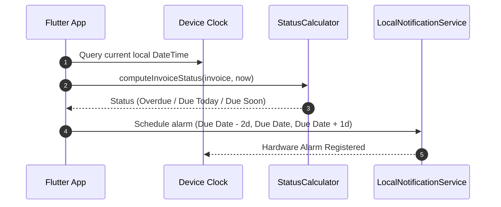
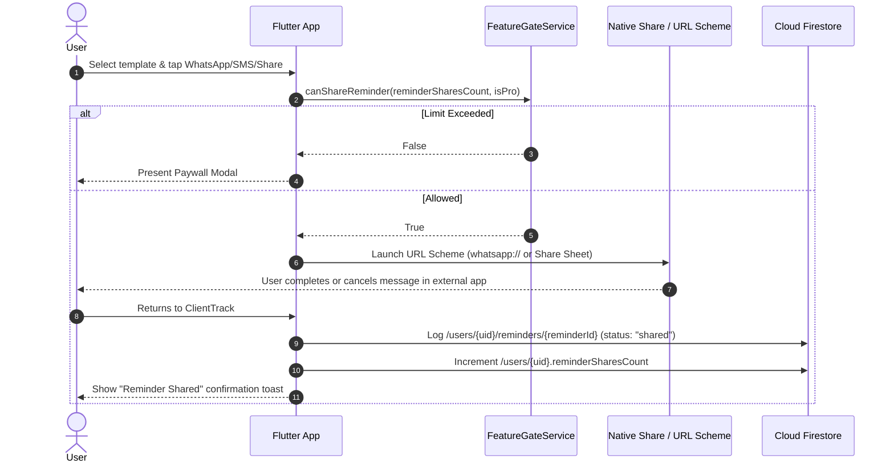
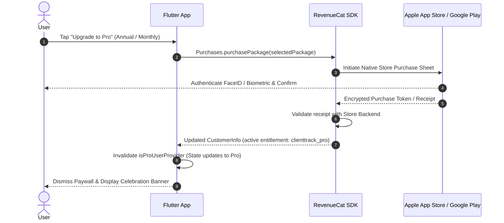
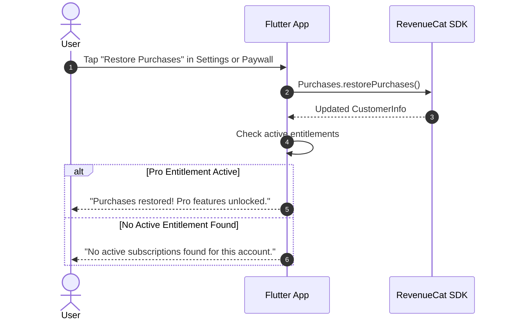

# ClientTrack — Technical Architecture Document

---

## 1. Architecture Overview

ClientTrack is built using a reactive, offline-first client architecture powered by Flutter and Dart, backed by Firebase (Authentication, Cloud Firestore, Storage, and Cloud Functions) and RevenueCat for subscription lifecycle orchestration.



---

## 2. Tech Stack and Package Manifest

All packages must be verified against `pub.dev` for Flutter 3.13+ and Dart 3.x compatibility during project initialization.

| Package | Purpose | Priority | Version Target [VERIFY] |
| :--- | :--- | :---: | :--- |
| `flutter_riverpod` | Reactive state management, dependency injection, and caching | P0 | `^2.5.1` |
| `riverpod_annotation` / `build_runner` | Compile-time code generation for type-safe providers | P0 | `^2.3.5` |
| `go_router` | Declarative deep-linkable routing with sub-routes & shell routes | P0 | `^14.0.0` |
| `firebase_core` | Firebase application initialization | P0 | `^3.0.0` |
| `firebase_auth` | User identity, email/password sessions, token refresh | P0 | `^5.0.0` |
| `cloud_firestore` | Document database with automatic offline persistence | P0 | `^5.0.0` |
| `purchases_flutter` | RevenueCat SDK for subscription management & paywall receipt validation | P0 | `^8.0.0` |
| `pdf` | High-fidelity vector PDF generation on-device | P0 | `^3.10.8` |
| `printing` | Native print preview, PDF rasterization, and direct OS share | P0 | `^5.13.1` |
| `flutter_local_notifications` | Hardware-scheduled background notifications for due dates/deadlines | P0 | `^17.1.0` |
| `timezone` | Timezone database for precise local calendar scheduling | P0 | `^0.9.3` |
| `share_plus` | Cross-platform access to native OS sharing tray | P0 | `^9.0.0` |
| `url_launcher` | Custom deep link scheme execution (`whatsapp://`, `sms:`, `mailto:`) | P0 | `^6.3.0` |
| `fl_chart` | High-performance dashboard financial charts | P0 | `^0.68.0` |
| `intl` | Date formatting, currency localization, and number parsing | P0 | `^0.19.0` |
| `uuid` | RFC4122 v4 unique identifier generation | P0 | `^4.4.0` |
| `firebase_storage` | Cloud storage for user company logos (Pro) | P1 | `^12.0.0` |
| `cloud_functions` | Invoking authenticated Cloud Functions for AI polishing | P1 | `^5.0.0` |
| `google_sign_in` | Native Google OAuth sign-in flow (Android) | P1 | `^6.2.1` |

---

## 3. Project Structure

ClientTrack adheres to a **Feature-First Architecture** with strict layer separation:

```text
lib/
├── app/
│   ├── app.dart                   # MaterialApp.router configuration
│   ├── router/                    # go_router configuration & redirect guards
│   │   ├── app_router.dart
│   │   └── route_names.dart
│   └── theme/                     # Design tokens, color schemes & ThemeData
│       ├── app_colors.dart
│       ├── app_typography.dart
│       └── app_theme.dart
├── core/
│   ├── constants/                 # App-wide constants, limits & asset paths
│   │   ├── app_constants.dart
│   │   └── entitlement_constants.dart
│   ├── errors/                    # Failure & exception definitions
│   │   ├── exceptions.dart
│   │   └── failures.dart
│   ├── services/                  # Platform & core engine services
│   │   ├── date_time_service.dart
│   │   ├── deep_link_service.dart
│   │   ├── local_notification_service.dart
│   │   ├── pdf_generator_service.dart
│   │   ├── reminder_template_engine.dart
│   │   └── seed_data_service.dart
│   └── utils/                     # Formatters, loggers, validation helpers
│       ├── currency_formatter.dart
│       ├── date_formatter.dart
│       └── validator.dart
├── features/
│   ├── auth/
│   │   ├── data/                  # FirebaseAuth repository & user DTOs
│   │   ├── domain/                # Auth entity & credentials models
│   │   └── presentation/          # Login, SignUp, ForgotPassword screens
│   ├── clients/
│   │   ├── data/                  # Firestore client repository
│   │   ├── domain/                # Client model & payment history calculator
│   │   └── presentation/          # ClientList, ClientDetail, AddEditClient screens
│   ├── projects/
│   │   ├── data/                  # Firestore project repository
│   │   ├── domain/                # Project model & status enum
│   │   └── presentation/          # ProjectList, ProjectDetail, AddEditProject screens
│   ├── invoices/
│   │   ├── data/                  # Firestore invoice repository
│   │   ├── domain/                # Invoice, LineItem models & status derivation
│   │   └── presentation/          # InvoiceList, InvoiceDetail, CreateInvoice, PDFPreview
│   ├── chaser/
│   │   ├── data/                  # Firestore reminder history repository
│   │   ├── domain/                # Reminder model & template types
│   │   └── presentation/          # NeedsFollowUpScreen, ReminderComposerSheet
│   ├── dashboard/
│   │   ├── data/                  # Aggregation provider from client/invoice streams
│   │   ├── domain/                # DashboardSummary metric models
│   │   └── presentation/          # DashboardScreen & metric widgets
│   ├── monetization/
│   │   ├── data/                  # RevenueCat repository wrapper
│   │   ├── domain/                # SubscriptionState & Entitlement models
│   │   └── presentation/          # PaywallScreen, LimitReachedSheet, ProBadge
│   ├── settings/
│   │   ├── data/                  # User profile repository
│   │   ├── domain/                # UserProfile model
│   │   └── presentation/          # SettingsScreen, BusinessProfileScreen
│   └── onboarding/
│       ├── data/                  # Local storage first-run repository
│       └── presentation/          # SplashScreen, OnboardingScreen, ProfileSetupScreen
└── shared/
    └── widgets/                   # Reusable atomic UI components
        ├── buttons/               # PrimaryButton, OutlineButton, GhostButton
        ├── inputs/                # CustomTextField, DatePickerField, DropdownField
        ├── cards/                 # SummaryCard, ActionCard, ItemCard
        ├── chips/                 # StatusChip, PillChip
        └── feedback/              # EmptyStateWidget, ErrorView, ConfirmationDialog
```

---

## 4. State Management with Riverpod

ClientTrack utilizes `flutter_riverpod` (v2.x) with code generation. State flows unidirectionally from repositories through application controllers to the UI.

### 4.1 Provider Types and Naming Conventions
- **Data Source / Repository Providers** (`@Riverpod(keepAlive: true)`): Global singletons interfacing with Firestore or RevenueCat (e.g., `clientRepositoryProvider`).
- **Stream Providers** (`StreamProvider<List<T>>`): Emitting real-time snapshots from Firestore subcollections (e.g., `clientListStreamProvider`, `invoicesStreamProvider`).
- **Controller Providers** (`@riverpod class FeatureController extends _$FeatureController`): Managing async state (`AsyncValue<void>`) during mutations (e.g., `invoiceFormControllerProvider`).
- **Computed Providers** (`@riverpod`): Pure selector functions aggregating multi-source state (e.g., `dashboardSummaryProvider`, `needsFollowUpInvoicesProvider`, `clientPaymentHistoryProvider(clientId)`).

### 4.2 Example Provider Graph



---

## 5. Navigation Architecture with go_router

The app utilizes `go_router` with a root `ShellRoute` hosting a persistent 5-tab Bottom Navigation Bar.

### 5.1 Route Hierarchy and Screen Registry

| Route Path | Screen Name | Tab Shell? | Access Level | Description |
| :--- | :--- | :---: | :---: | :--- |
| `/splash` | `01 Splash` | No | Public | Initial auth/session check & splash render |
| `/onboarding` | `02 Onboarding` | No | Public | First-run 3-slide value carousel |
| `/auth/signup` | `03 Sign Up` | No | Public | Email & password registration |
| `/auth/login` | `04 Login` | No | Public | Email & password authentication |
| `/auth/forgot-password`| `05 Forgot Password` | No | Public | Password reset email dispatch |
| `/profile-setup` | `06 Profile Setup` | No | Auth Required| Initial business profile creation |
| `/dashboard` | `07 Dashboard` | **Tab 1** | Auth Required| Overview metrics, Needs Follow-up card |
| `/clients` | `08 Client List` | **Tab 2** | Auth Required| Client directory with search |
| `/clients/add` | `09 Add Client` | No | Auth Required| Create client form |
| `/clients/:id/edit` | `09 Edit Client` | No | Auth Required| Edit client form |
| `/clients/:id` | `10 Client Detail` | No | Auth Required| Client profile, history & invoices |
| `/projects` | `11 Project List` | **Tab 3** | Auth Required| Project cards filtered by status |
| `/projects/add` | `12 Add Project` | No | Auth Required| Create project form |
| `/projects/:id/edit` | `12 Edit Project` | No | Auth Required| Edit project form |
| `/projects/:id` | `13 Project Detail` | No | Auth Required| Project deliverables & invoices |
| `/invoices` | `14 Invoice List` | **Tab 4** | Auth Required| Invoices sorted by issue/due date |
| `/invoices/create` | `15 Create Invoice` | No | Auth Required| Invoice builder with line items |
| `/invoices/:id` | `16 Invoice Detail` | No | Auth Required| Itemized view & mark-paid actions |
| `/invoices/:id/pdf` | `17 PDF Preview` | No | Auth Required| Full-screen PDF preview & OS share |
| `/chaser/needs-follow-up`| `18 Needs Follow-up`| No | Auth Required| Urgent invoices requiring reminders |
| `/chaser/compose/:id` | `19 Reminder Composer`| Modal | Auth Required| Template selection & share sheet |
| `/paywall` | `20 Paywall` | Modal | Auth Required| Dedicated subscription purchase screen |
| `/settings` | `21 Settings` | **Tab 5** | Auth Required| Account, subscription & legal links |
| `/settings/business` | `22 Business Profile` | No | Auth Required| Company address, logo & default terms |

---

## 6. Data Model

### 6.1 Entity-Relationship Diagram



### 6.2 Entity Schema Definitions

#### UserProfile
- `uid`: `String` (Required, PK)
- `email`: `String` (Required)
- `fullName`: `String` (Required)
- `businessName`: `String` (Required)
- `currencyCode`: `String` (Required, default `"USD"`)
- `phone`: `String?` (Optional)
- `logoUrl`: `String?` (Optional, Pro P1)
- `reminderSharesCount`: `int` (Required, default `0`, free-tier usage counter)
- `createdAt`: `DateTime` (Required)
- `updatedAt`: `DateTime` (Required)

#### Client
- `id`: `String` (Required, PK)
- `userId`: `String` (Required, FK to UserProfile)
- `name`: `String` (Required)
- `email`: `String?` (Optional)
- `phone`: `String?` (Optional)
- `company`: `String?` (Optional)
- `notes`: `String?` (Optional)
- `isSampleData`: `bool` (Required, default `false`)
- `createdAt`: `DateTime` (Required)
- `updatedAt`: `DateTime` (Required)

#### Project
- `id`: `String` (Required, PK)
- `userId`: `String` (Required, FK to UserProfile)
- `clientId`: `String` (Required, FK to Client)
- `title`: `String` (Required)
- `description`: `String?` (Optional)
- `status`: `String` (`"not_started" | "in_progress" | "completed"`, default `"not_started"`)
- `rate`: `double` (Required, default `0.0`)
- `rateType`: `String` (`"fixed" | "hourly"`, default `"fixed"`)
- `deadline`: `DateTime?` (Optional)
- `isSampleData`: `bool` (Required, default `false`)
- `createdAt`: `DateTime` (Required)
- `updatedAt`: `DateTime` (Required)

#### Invoice & LineItem
- `id`: `String` (Required, PK)
- `userId`: `String` (Required, FK to UserProfile)
- `clientId`: `String` (Required, FK to Client)
- `clientName`: `String` (Required, denormalized for rapid list rendering)
- `projectId`: `String?` (Optional, FK to Project)
- `invoiceNumber`: `String` (Required, e.g. `"INV-0001"`)
- `issueDate`: `DateTime` (Required)
- `dueDate`: `DateTime` (Required)
- `paidAt`: `DateTime?` (Optional, recorded when marked paid)
- `status`: `String` (`"draft" | "sent" | "paid"`)
- `lineItems`: `List<LineItem>` (Embedded array of objects)
  - `LineItem.id`: `String` (UUID)
  - `LineItem.description`: `String`
  - `LineItem.quantity`: `double`
  - `LineItem.rate`: `double`
  - `LineItem.amount`: `double` ($\text{quantity} \times \text{rate}$)
- `subtotal`: `double` (Required)
- `total`: `double` (Required)
- `notes`: `String?` (Optional)
- `isSampleData`: `bool` (Required, default `false`)
- `createdAt`: `DateTime` (Required)
- `updatedAt`: `DateTime` (Required)

#### Reminder
- `id`: `String` (Required, PK)
- `userId`: `String` (Required, FK to UserProfile)
- `invoiceId`: `String` (Required, FK to Invoice)
- `clientId`: `String` (Required, FK to Client)
- `templateType`: `String` (`"friendly" | "professional" | "final"`)
- `channel`: `String` (`"whatsapp" | "sms" | "email" | "other"`)
- `status`: `String` (Strictly `"shared"`, never `"sent"`)
- `sharedAt`: `DateTime` (Required)

---

### 6.3 Derived Fields & Business Logic

#### Deterministic Invoice Status Derivation
Overdue is never stored as a mutable static database field to prevent staleness:
```dart
InvoiceDisplayStatus computeInvoiceStatus(Invoice invoice, DateTime now) {
  if (invoice.paidAt != null || invoice.status == 'paid') {
    return InvoiceDisplayStatus.paid;
  }
  final todayMidnight = DateTime(now.year, now.month, now.day);
  final dueMidnight = DateTime(invoice.dueDate.year, invoice.dueDate.month, invoice.dueDate.day);

  if (dueMidnight.isBefore(todayMidnight)) {
    return InvoiceDisplayStatus.overdue;
  } else if (dueMidnight.isAtSameMomentAs(todayMidnight)) {
    return InvoiceDisplayStatus.dueToday;
  } else if (dueMidnight.difference(todayMidnight).inDays <= 3) {
    return InvoiceDisplayStatus.dueSoon;
  } else {
    return invoice.status == 'sent' ? InvoiceDisplayStatus.sent : InvoiceDisplayStatus.draft;
  }
}
```

#### Deterministic Client Payment History Calculator
Computed dynamically from the client's historical invoices:
```dart
class ClientPaymentHistory {
  final double totalBilled;
  final double totalPaid;
  final double outstanding;
  final double avgDaysLate;
  final double onTimePercentage;
  final ReliabilityTier tier;

  ClientPaymentHistory({
    required this.totalBilled,
    required this.totalPaid,
    required this.outstanding,
    required this.avgDaysLate,
    required this.onTimePercentage,
    required this.tier,
  });
}

enum ReliabilityTier { reliable, sometimesLate, chronicallyLate }

ClientPaymentHistory calculateClientHistory(List<Invoice> invoices) {
  final paidInvoices = invoices.where((inv) => inv.paidAt != null).toList();
  double totalBilled = invoices.fold(0, (sum, i) => sum + i.total);
  double totalPaid = paidInvoices.fold(0, (sum, i) => sum + i.total);
  double outstanding = totalBilled - totalPaid;

  if (paidInvoices.isEmpty) {
    return ClientPaymentHistory(
      totalBilled: totalBilled,
      totalPaid: totalPaid,
      outstanding: outstanding,
      avgDaysLate: 0,
      onTimePercentage: 100.0,
      tier: ReliabilityTier.reliable,
    );
  }

  int totalLateDays = 0;
  int onTimeCount = 0;

  for (final inv in paidInvoices) {
    final paidDate = inv.paidAt!;
    final dueDate = inv.dueDate;
    final diff = paidDate.difference(dueDate).inDays;
    if (diff <= 0) {
      onTimeCount++;
    } else {
      totalLateDays += diff;
    }
  }

  final avgDaysLate = totalLateDays / paidInvoices.length;
  final onTimePercentage = (onTimeCount / paidInvoices.length) * 100.0;

  ReliabilityTier tier;
  if (avgDaysLate <= 0) {
    tier = ReliabilityTier.reliable;
  } else if (avgDaysLate <= 14) {
    tier = ReliabilityTier.sometimesLate;
  } else {
    tier = ReliabilityTier.chronicallyLate;
  }

  return ClientPaymentHistory(
    totalBilled: totalBilled,
    totalPaid: totalPaid,
    outstanding: outstanding,
    avgDaysLate: avgDaysLate,
    onTimePercentage: onTimePercentage,
    tier: tier,
  );
}
```

---

## 7. Firestore Database Design

### 7.1 Hierarchy and Document Shapes
All documents are strictly partitioned under the user's root UID:
- `/users/{uid}` (User profile document)
- `/users/{uid}/clients/{clientId}`
- `/users/{uid}/projects/{projectId}`
- `/users/{uid}/invoices/{invoiceId}`
- `/users/{uid}/reminders/{reminderId}`

### 7.2 Composite Indexes Required
To support sorting and real-time dashboard filtering:
1. Collection: `/users/{uid}/invoices`
   - `dueDate` ASC, `createdAt` DESC
2. Collection: `/users/{uid}/invoices`
   - `clientId` ASC, `dueDate` DESC
3. Collection: `/users/{uid}/projects`
   - `clientId` ASC, `deadline` ASC
4. Collection: `/users/{uid}/reminders`
   - `invoiceId` ASC, `sharedAt` DESC

### 7.3 Offline Persistence Settings
Offline persistence is enabled explicitly at startup:
```dart
FirebaseFirestore.instance.settings = const Settings(
  persistenceEnabled: true,
  cacheSizeBytes: Settings.CACHE_SIZE_UNLIMITED,
);
```

---

## 8. Core Services

### 8.1 PDF Generation Service (`pdf` + `printing`)
- High-resolution A4 document layout using `pw.Document`.
- Dynamic header: user name, business name, phone, email, client name, and issue/due dates.
- Line items table with auto-expanding rows, right-aligned monetary values, and subtotal/total block.
- **Watermark Rule**:
  - Free Tier: Includes footer text *"Made with ClientTrack — Professional Freelancer Invoicing"*.
  - Pro Tier: Clean, unbranded professional footer or custom notes.
- Byte stream is piped directly to `Printing.layoutPdf` or cached in temporary storage for `Printing.sharePdf`.

### 8.2 Native Share & Deep Link Service
Coordinates handoff to messaging channels without claiming message delivery:
- **WhatsApp**: Encodes phone and body into `whatsapp://send?phone=$cleanPhone&text=$encodedText`.
- **SMS**: Invokes `sms:$phone?body=$encodedText`.
- **Email**: Invokes `mailto:$email?subject=$encodedSubject&body=$encodedBody`.
- **System Share**: Falls back to `Share.share(text, subject: subject)` opening the native OS share sheet.
- **Lifecycle Hook**: Upon returning to the Flutter foreground, creates a `Reminder` entry with `status: 'shared'` and increments `reminderSharesCount` in the user's profile.

### 8.3 Notification Scheduling Service
Manages local device alerts while respecting iOS's strict 64 pending notification ceiling:
1. **Capacity Budget**:
   - Max 40 slots allocated to upcoming invoice due dates and overdue escalations.
   - Max 10 slots allocated to project deadlines.
2. **Scheduling Rules**:
   - Trigger 1: 2 days before due date at 09:00 AM local time (*"Invoice INV-0001 is due in 2 days"*).
   - Trigger 2: On due date at 09:00 AM local time (*"Invoice INV-0001 is due today"*).
   - Trigger 3: 1 day overdue at 10:00 AM local time (*"Invoice INV-0001 is now overdue — follow up now"*).
3. **Reschedule & Cancel**:
   - Whenever an invoice is edited or marked paid, its notification IDs (`invoice.hashCode + offset`) are systematically cancelled via `flutterLocalNotificationsPlugin.cancel(id)`.

### 8.4 Reminder Template Engine
Interpolates dynamic tokens into three escalating tones:
- **Friendly**:
  > *"Hi {client_name}, hope you're having a great week! Just a friendly reminder that invoice {invoice_number} for {amount} is due on {due_date}. Please let me know if you have any questions!"*
- **Professional**:
  > *"Dear {client_name}, this is a follow-up regarding invoice {invoice_number} ({amount}), which was due on {due_date}. Could you please confirm when payment will be processed? Thank you for your prompt attention."*
- **Final**:
  > *"URGENT: Dear {client_name}, invoice {invoice_number} for {amount} is now significantly overdue. Please arrange immediate payment today to keep your account in good standing. Thank you."*

---

## 9. Monetization Architecture (RevenueCat)

### 9.1 SDK Initialization & Lifecycle
```dart
Future<void> initRevenueCat(String userId) async {
  await Purchases.setLogLevel(LogLevel.debug);
  PurchasesConfiguration configuration;
  if (Platform.isAndroid) {
    configuration = PurchasesConfiguration('goog_public_api_key_placeholder');
  } else {
    configuration = PurchasesConfiguration('appl_public_api_key_placeholder');
  }
  configuration.appUserID = userId; // Linked to Firebase UID
  await Purchases.configure(configuration);
}
```

### 9.2 Entitlement & Gating Service
- Entitlement ID: **`clienttrack_pro`**
- Monitored continuously via `Purchases.addCustomerInfoUpdateListener`.
- Cached locally by RevenueCat SDK; permits offline pro validation if subscription was active during last online check.
- **FeatureGateService** exposes synchronous checks:
  ```dart
  bool canCreateClient(int currentCount, bool isPro) => isPro || currentCount < 3;
  bool canCreateInvoice(int currentCount, bool isPro) => isPro || currentCount < 5;
  bool canShareReminder(int lifetimeShares, bool isPro) => isPro || lifetimeShares < 3;
  ```

### 9.3 Store Sandbox Matrix
1. **Active Purchase**: Test Monthly & Annual in StoreKit Sandbox / Play License Testing.
2. **Restore**: Delete local storage, log in with existing account, tap "Restore Purchases" $\to$ entitlement reactivated.
3. **Cancellation & Expiry**: Accelerated sandbox time (5-minute renewals); verify UI reverts to Free tier upon entitlement expiration without crash.

---

## 10. AI Reminder Architecture (P1 Feature)



---

## 11. Error Handling and Logging

- **No PII Logging**: Client names, phone numbers, email addresses, and invoice dollar amounts are never logged to console or crash reporting tools.
- **User-Facing Failures**: System exceptions map to human-readable strings via a central `FailureMapper` (e.g., `NetworkFailure` $\to$ *"Network connection unavailable. Changes saved locally."*).
- **Graceful Degradation**: If RevenueCat or Cloud Functions are unreachable, local templates and cached entitlements allow the user to complete their urgent invoicing tasks.

---

## 12. Environments and Configuration

- **Dev / Staging**: Firebase Project `clienttrack-dev`, RevenueCat Project `ClientTrack-Dev` (Sandbox API keys).
- **Production**: Firebase Project `clienttrack-prod`, RevenueCat Project `ClientTrack` (Live StoreKit / Play Billing credentials).
- **Secrets Management**: Public client keys (RevenueCat public SDK key) configured via `--dart-define` at compile time. Cloud Functions secrets stored in Google Cloud Secret Manager.

---

## 13. Testing Strategy

1. **Unit Testing (`test/unit/`)**:
   - `invoice_status_derivation_test.dart`: Validates boundaries (yesterday, today, tomorrow, due soon, paid).
   - `client_payment_history_test.dart`: Validates average days late calculations, on-time percentage, and tier assignment.
   - `feature_gate_service_test.dart`: Validates Free limit boundaries (3 clients, 5 invoices, 3 shares).
2. **Widget Testing (`test/widget/`)**:
   - Verification of UI state changes (empty states, buttons disabling during async calls, status chip colors).
3. **Integration & Sandbox Testing**:
   - RevenueCat sandbox purchasing on Android device / iOS simulator.
   - End-to-end invoice creation, PDF generation, and share trigger.

---

## 14. CI/CD and Release Pipeline

- **GitHub Actions / Local Fastlane**:
  - Step 1: `flutter analyze` & `flutter test`
  - Step 2: Build release bundles (`flutter build appbundle --release`, `flutter build ipa --release`)
  - Step 3: Fastlane upload to Google Play Internal Testing & Apple TestFlight.

---

## 15. Key Technical Decisions & Rationale

| Decision | Rationale | Alternatives Considered |
| :--- | :--- | :--- |
| **Cloud Firestore Offline Persistence over Isar** | Firestore provides built-in multi-platform offline synchronization out of the box with zero schema compilation overhead, avoiding complex custom sync conflict resolution between local Isar and cloud databases. | Isar / Hive / SQLite + custom sync |
| **Share Sheet over Direct Messaging APIs** | WhatsApp Business API and Twilio have high costs, strict verification gates, and require outbound server architecture. The native share sheet leverages the user's authentic personal identity with 100% deliverability to their preferred messaging apps. | Twilio SMS, SendGrid API, WhatsApp Cloud API |
| **Deterministic Derived Overdue Status** | Storing `status: 'overdue'` in a database leads to stale records if a background server cron job fails. Computing overdue on-device comparing `dueDate` against local midnight guarantees 100% accuracy. | Server-side cron updater |
| **RevenueCat for Monetization** | Normalizes complex StoreKit 2 and Google Play Billing v6 lifecycle events, handles receipt validation, grace periods, and cross-platform entitlement state with minimal client boilerplate. | Direct StoreKit / Play Billing implementation |

---

## 16. Technical Risks & Open Questions (VERIFY)

- **[VERIFY-TECH-01]**: Verify Flutter 3.13 / Dart 3 package compatibility for `purchases_flutter` v8.x and `flutter_local_notifications` v17.x.
- **[VERIFY-TECH-02]**: Verify Firebase Cloud Functions runtime compatibility (Node.js 20) and ensure Secret Manager is enabled if P1 AI features are deployed.
- **[VERIFY-TECH-03]**: Validate Android 14 exact alarm permission requirements (`SCHEDULE_EXACT_ALARM`) for `flutter_local_notifications`.

---

## 17. Sequence Diagrams

### 17.1 User Sign-Up Flow


### 17.2 Create Invoice Flow


### 17.3 Derive Overdue & Schedule Notification Flow


### 17.4 Share Reminder Flow


### 17.5 Purchase Pro Subscription Flow


### 17.6 Restore Purchases Flow


### 17.7 Account Deletion Flow
```mermaid
sequenceDiagram
    autonumber
    actor User
    participant App as Flutter App
    participant FS as Cloud Firestore
    participant Notif as NotificationService
    participant Auth as Firebase Auth

    User->>App: Tap "Delete Account" in Settings
    App-->>User: Present Warning Modal (Data deleted, cancel store sub in settings)
    User->>App: Confirm Deletion
    App->>Notif: cancelAllNotifications()
    App->>FS: Batch delete /users/{uid} and all subcollections
    App->>Auth: currentUser.delete()
    Auth-->>App: Deletion Confirmed
    App->>App: Clear local state & route to /auth/login
